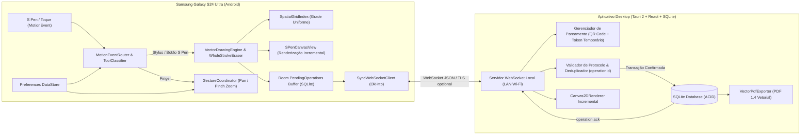

# Arquitetura do Sistema — Digital Notebook (S Pen + Desktop)

## 1. Visão Geral da Arquitetura

O sistema **Digital Notebook** é dividido em três pacotes principais dentro de um monorepo:

1. **`protocol/`**: Contratos formais do protocolo WebSocket, esquemas de validação, modelo geométrico vetorial, índice espacial (`SpatialGridIndex`) e algoritmos de interseção da borracha.
2. **`android-app/`**: Aplicativo Android nativo em Kotlin + Jetpack Compose + `SPenCanvasView` (Android `View` customizada para captura `MotionEvent` de baixíssima latência), com persistência de preferências via `DataStore` e fila durável de operações pendentes via `Room` (SQLite).
3. **`desktop-app/`**: Aplicativo Desktop em React + TypeScript (`strict`) + Vite + Tauri 2 (Rust + SQLite + WebSocket Server), acompanhado de um servidor Node.js + `node:sqlite` compatível que permite execução tanto empacotada via Tauri quanto standalone em ambientes sem o compilador Rust instalado.

---

## 2. Sistema de Coordenadas Lógicas e Modelo Vetorial

Para garantir independência total da resolução da tela do Samsung Galaxy S24 Ultra (ex.: QHD+ `1440 x 3120` ou FHD+ `1080 x 2340`) e do tamanho da janela do monitor no Desktop:

- **Espaço Lógico da Página**: Toda página possui dimensões lógicas padrão de **`1000.0` (largura) × `1414.2135` (altura)** unidades lógicas (proporção ISO A4 exata $1 : \sqrt{2}$).
- **Transformação de Viewport (`ViewportTransform`)**:
  - $x_{\text{tela}} = x_{\text{lógico}} \cdot s + t_x$
  - $y_{\text{tela}} = y_{\text{lógico}} \cdot s + t_y$
  - Conversão inversa na captura de eventos:
    $$x_{\text{lógico}} = \frac{x_{\text{tela}} - t_x}{s}, \quad y_{\text{lógico}} = \frac{y_{\text{tela}} - t_y}{s}$$
- **Imutabilidade Geométrica no Zoom/Pan**: O zoom por pinça e o deslocamento por dedo modificam **exclusivamente** $(s, t_x, t_y)$ do `ViewportTransform`. Os pontos dos traços permanecem armazenados em coordenadas lógicas puras.

### Estrutura de um Traço (`Stroke`)

Cada traço é um objeto vetorial autônomo contendo:
- `id`: UUID / identificador único determinístico.
- `pageId`: ID da página à qual pertence.
- `notebookId`: ID do caderno.
- `color`: Cor hexadecimal (`#RRGGBB` ou `#RRGGBBAA`).
- `baseWidth`: Espessura base em unidades lógicas (ex.: `1.5` a `24.0`).
- `toolType`: `"pen"` (sempre um traço visível; a borracha não cria traços de cor de fundo, mas remove objetos inteiros).
- `points`: Lista ordenada de `StrokePoint`:
  - `x`, `y`: Coordenadas lógicas.
  - `pressure`: Pressão normalizada $[0.0, 1.0]$ capturada da S Pen (`MotionEvent.getPressure`).
  - `tiltX`, `tiltY` / `tilt`, `orientation`: Dados angulares da S Pen quando disponíveis.
  - `t`: Timestamp relativo em milissegundos desde o `ACTION_DOWN` do traço (`eventTime - downTime`).

---

## 3. Pipeline de Entrada e Rejeição de Palma no Android

1. **Classificação Estrita (`ToolClassifier`)**:
   - Inspeciona `event.getToolType(pointerIndex)` antes de qualquer ação:
     - `MotionEvent.TOOL_TYPE_STYLUS` com `(event.buttonState and MotionEvent.BUTTON_STYLUS_PRIMARY) != 0` $\rightarrow$ **`STYLUS_ERASER`** (Borracha por traço inteiro).
     - `MotionEvent.TOOL_TYPE_ERASER` $\rightarrow$ **`STYLUS_ERASER`**.
     - `MotionEvent.TOOL_TYPE_STYLUS` (sem botão pressionado) $\rightarrow$ **`STYLUS_PEN`** (ou `STYLUS_ERASER` se a ferramenta selecionada na barra for a borracha).
     - `MotionEvent.TOOL_TYPE_FINGER` $\rightarrow$ **`FINGER`**.
2. **Coordenador de Gestos (`GestureCoordinator`)**:
   - Enquanto um ponteiro `STYLUS_PEN` ou `STYLUS_ERASER` estiver ativo (ou em hover próximo), todos os ponteiros `FINGER` simultâneos são bloqueados pelo coordenador para evitar deslocamento involuntário da página pela palma da mão.
   - Quando apenas `FINGER` está presente:
     - **1 dedo**: Aplica scroll conforme `fingerMode` (`both`, `vertical`, `horizontal`, `none`) e `scrollMode` (`free` ou `axisLocked`, onde o eixo dominante nos primeiros `8dp` de movimento trava o deslocamento).
     - **2 dedos**: Se `pinchZoom == true`, calcula o centro focal e a razão de distância entre os dois dedos para aplicar zoom ancorado no ponto focal + pan simultâneo.
3. **Política de Rejeição de Palma (`PalmRejectionPolicy`)**:
   - Traços iniciados em `ACTION_DOWN` permanecem em um **buffer provisório (`provisionalStroke`)** até `ACTION_UP`.
   - Se o sistema operacional emitir `ACTION_CANCEL` ou definir `(event.flags and MotionEvent.FLAG_CANCELED) != 0`, o traço provisório é descartado imediatamente da camada de renderização ativa e uma mensagem de cancelamento local impede o envio de `stroke.end`.

---

## 4. Algoritmo da Borracha por Traço Inteiro (`WholeStrokeEraser`)

Quando o usuário mantém pressionado o botão lateral da S Pen (ou seleciona a borracha):

1. A cada evento `ACTION_DOWN` ou `ACTION_MOVE` (incluindo todos os pontos históricos intermediários entre amostras de 120Hz/240Hz), o sistema constrói o caminho varrido pela ponta da borracha com raio lógico $r_{\text{eraser}}$.
2. Consulta o **`SpatialGridIndex`** (grade espacial uniforme com células de `50 x 50` unidades lógicas):
   - Cada traço confirmado tem sua caixa delimitadora (*bounding box* expandida por `baseWidth / 2`) indexada nas células correspondentes.
   - A consulta retorna apenas os traços candidatos cujas células intersectam a região varrida pela borracha.
3. Para cada traço candidato (que ainda não esteja no conjunto `erasedInCurrentPass`):
   - Para cada segmento $\overline{P_i P_{i+1}}$ do traço e cada ponto amostrado $E$ da borracha, calcula a distância mínima ponto-segmento $d(E, \overline{P_i P_{i+1}})$.
   - Considera a espessura efetiva do traço naquele segmento:
     $$w_{\text{seg}} = \text{baseWidth} \cdot \left(0.35 + 0.90 \cdot \frac{p_i + p_{i+1}}{2}\right)$$
   - Se $d(E, \overline{P_i P_{i+1}}) \le r_{\text{eraser}} + \frac{w_{\text{seg}}}{2}$, há interseção!
4. O traço inteiro é imediatamente removido do modelo local e do índice espacial, seu ID é adicionado a `erasedInCurrentPass`, e uma operação `strokes.erase` contendo `operationId`, `pageId`, `targetStrokeIds` e os `removedStrokes` completos (para `undo` determinístico) é registrada e enviada ao desktop.

---

## 5. Persistência SQLite e Garantia de Sincronização

O banco SQLite no Desktop é a **fonte primária da verdade (Source of Truth)**:

- **Tabelas**:
  - `notebooks` (`id`, `title`, `created_at`, `updated_at`)
  - `pages` (`id`, `notebook_id`, `page_index`, `title`, `width`, `height`, `grid_enabled`, `grid_spacing`, `grid_color`, `grid_opacity`, `background_color`, `created_at`, `updated_at`)
  - `strokes` (`id`, `page_id`, `notebook_id`, `color`, `base_width`, `tool_type`, `points_json`, `is_deleted`, `created_op_id`, `deleted_op_id`, `created_at`)
  - `operations` (`operation_id`, `page_id`, `notebook_id`, `op_type`, `payload_json`, `undone`, `created_at`)
  - `paired_devices` (`device_id`, `device_name`, `session_token_hash`, `approved`, `paired_at`, `last_seen_at`)
- **Fluxo de Confirmação (`operation.ack`)**:
  - Toda mutação (`stroke.end`, `strokes.erase`, `operation.undo`, `operation.redo`) executa dentro de uma transação SQLite (`BEGIN IMMEDIATE ... COMMIT`).
  - Se `operation_id` já existir na tabela `operations`, a operação é reconhecida como **duplicada (idempotente)**: o servidor não reaplica a mutação nem causa efeitos colaterais, mas reenvia imediatamente o `operation.ack` correspondente.
  - O `operation.ack` **só é enviado ao Android após o término bem-sucedido do `COMMIT`**.
  - Ao receber `operation.ack`, o Android remove a operação correspondente de seu buffer local (`PendingOperationDao`).
